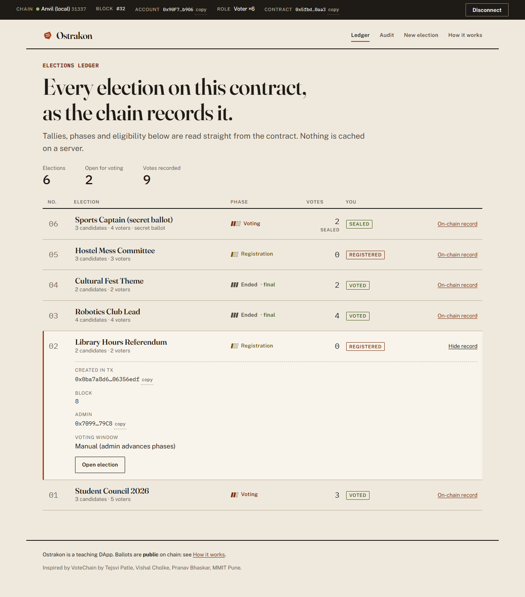
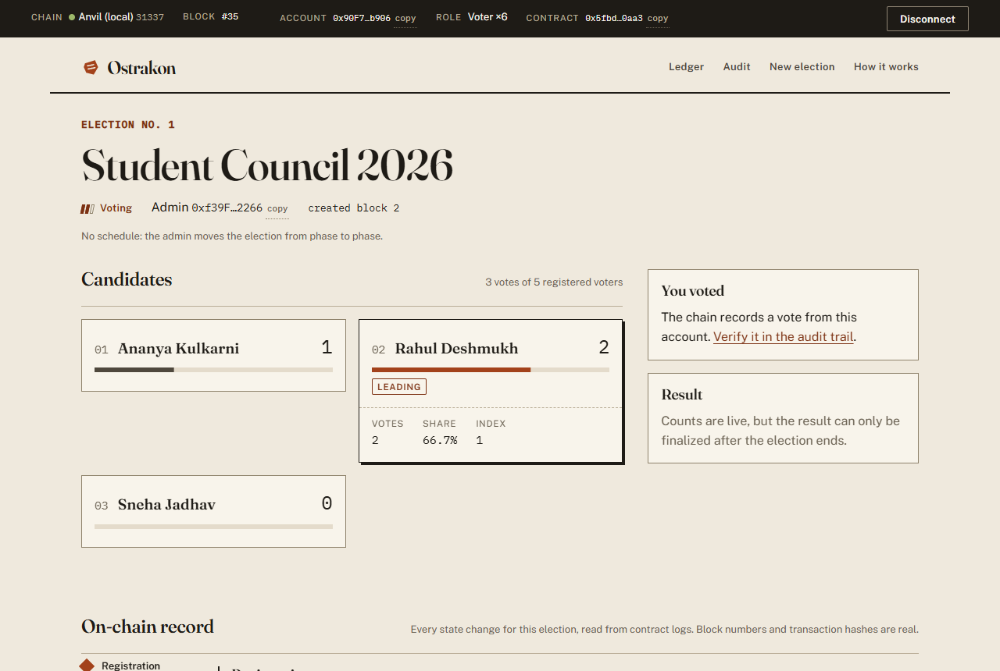
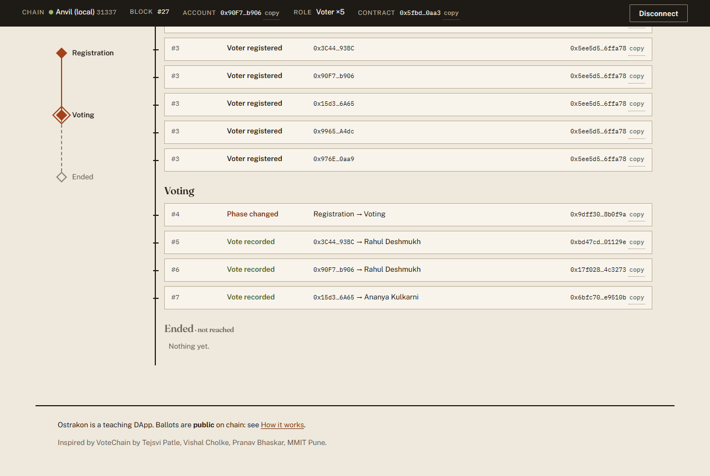
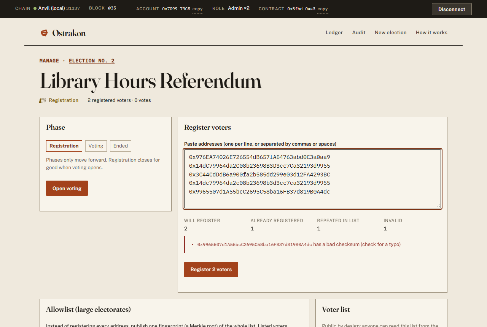
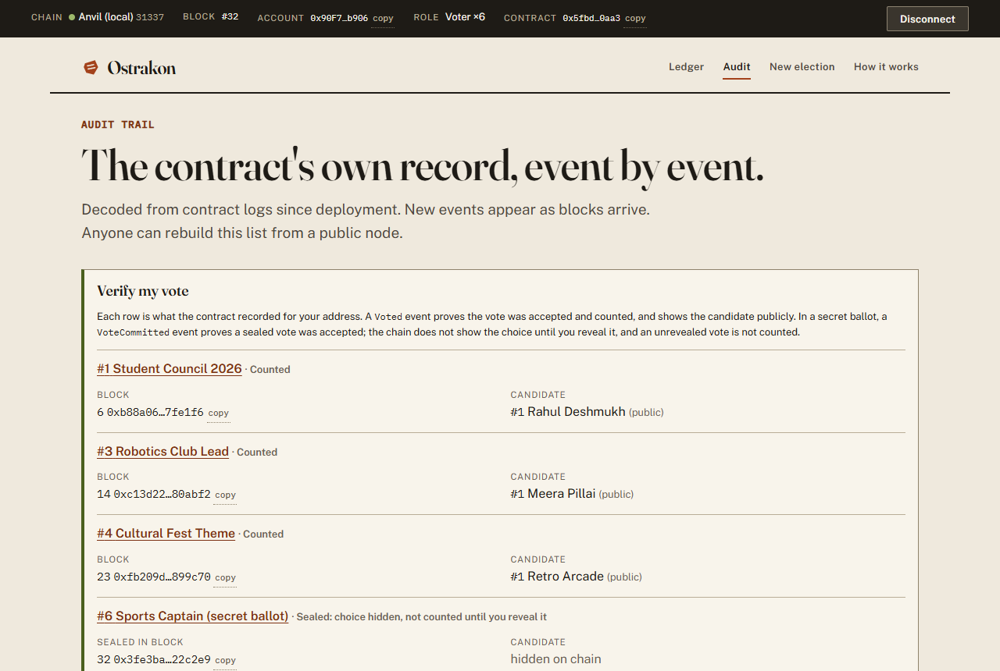
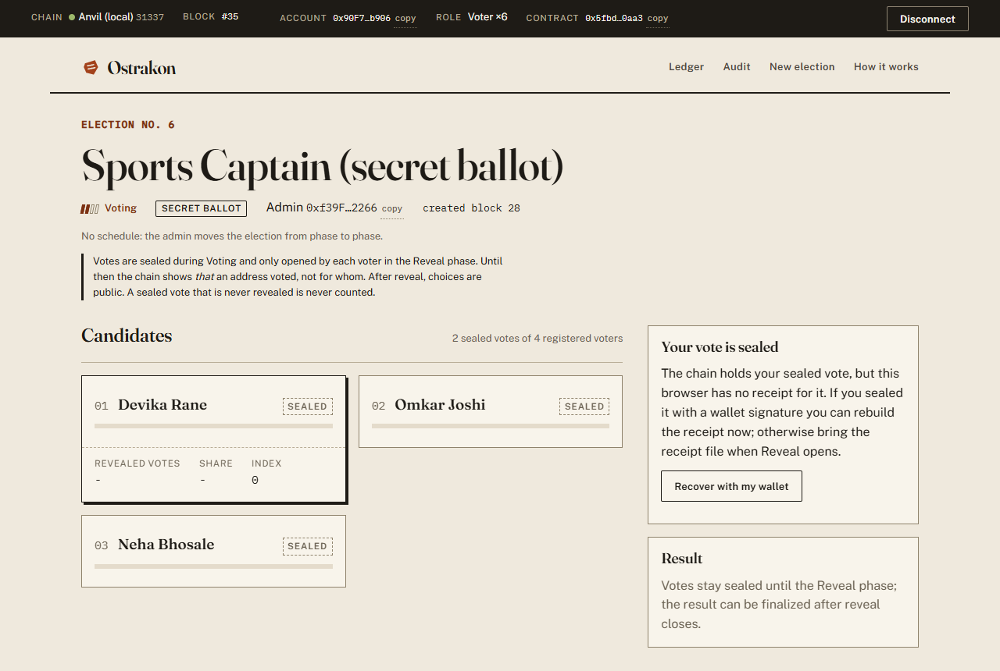
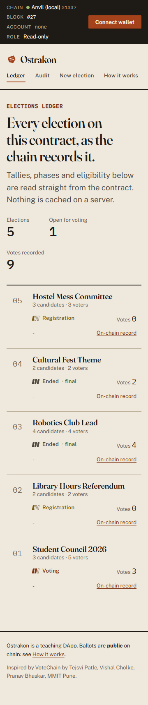
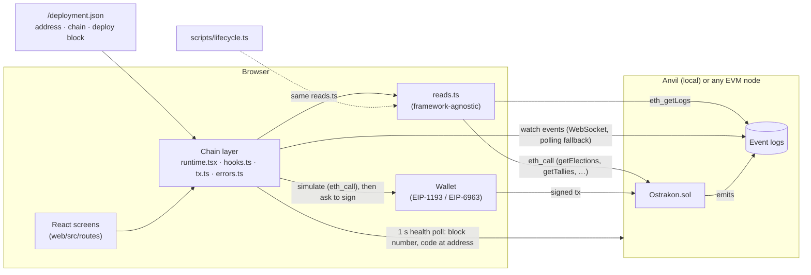

# Ostrakon

**Elections on a public ledger, with every rule enforced by the contract and every step left as a verifiable record.**

Anyone can open an election and administer it. The admin registers voter addresses, then moves the election forward through **Registration → Voting → Ended**. Those phases never go backwards, and if the admin publishes a schedule, it binds them too. Each registered address votes once, and anyone can finalize the result. The web app reads everything straight from the chain, with or without a wallet, and rebuilds the full audit trail from contract events.

Each election is either an **open ballot**, where a vote counts and is public the moment it's cast, or a **secret ballot** (commit–reveal). In a secret ballot, voters seal a hash of their choice during Voting and reveal it in an extra **Reveal** phase, so nobody can see choices or running totals while voting is open.

> **Choices don't stay secret forever.** In an open ballot, anyone can see which address voted for whom as soon as the vote is cast. In a secret ballot, the same becomes true when the voter reveals. Read [Security and privacy](#security-and-privacy) before using this for anything that matters.



## Quick start

You need **Node.js ≥ 20.19** and **[Foundry](https://getfoundry.sh)** (`forge` and `anvil`).

```bash
curl -L https://foundry.paradigm.xyz | bash && foundryup
```

```bash
git clone https://github.com/obstinix/ostrakon && cd ostrakon
```

```bash
npm install
```

```bash
npm run dev
```

Open **http://localhost:5173**.

`npm run dev` does the following:
1. Compiles the contract.
2. Generates typed ABIs for the app.
3. Starts a local Anvil chain.
4. Deploys the contract.
5. Seeds six demo elections: one in each phase, a finalized winner, a finalized tie, and a secret ballot that's open for sealed votes.
6. Writes `web/public/deployment.json`.
7. Starts the web app.

Nothing is copied by hand. Ctrl+C stops everything.

On Windows without bash, download the Foundry release zip from GitHub and put `forge.exe` and `anvil.exe` on your `PATH` or in `%USERPROFILE%\.foundry\bin`. The scripts look in both places, or you can set `FOUNDRY_BIN`.

### Wallet setup (only needed to act; reading works without one)

1. Run `npm run keys` to print the demo accounts, their roles, and their private keys. These are Anvil's **publicly known test keys**: never send real funds to them.
2. Import one of the keys into MetaMask (or any browser wallet).
3. Press **Connect wallet**. The app asks your wallet to switch to, or add, the Anvil network (chain id `31337`, RPC `http://127.0.0.1:8545`).

| Account | Good for seeing |
|---|---|
| #0 | Admin of elections 1, 3, 5, 6: manage, open and close voting, open and close reveal, finalize |
| #1 | Admin of elections 2, 4 |
| #2, #3 | Voters who have voted, and sealed a vote in the secret ballot (verify-my-vote receipts) |
| #4, #5 | Can seal a secret vote in election 6, then reveal it once #0 opens Reveal |
| #5, #6 | Registered in election 1 but haven't voted (cast an open vote) |
| #7 | Not registered anywhere (ineligible states) |

If you restart the chain while the app is running, the app tells you the contract is gone. `npm run chain:deploy` redeploys and reseeds, and the open page picks it up by itself.

## What you can do

| Screen | |
|---|---|
| **Ledger** (home) | Every election with its phase, total votes, and your status (admin, registered, voted). Each row expands to show its creation transaction, block, admin, and voting window. |
| **Election** | Candidate cards with live tallies. Open a card to see votes and share, and to vote with a two-step confirm. Also shows your eligibility, the result or finalize action, and the full on-chain record of the election alongside a phase rail that follows your scroll. In a secret ballot, tallies show as *sealed* until Reveal. **Seal vote** computes the commitment in your browser and keeps a receipt (with a download), and **Reveal** uses that receipt, or one you paste from another device. |
| **Manage** | Admin only. Paste a voter list and see a preview first: checksum errors, repeats, already-registered addresses, and the zero address. Lists longer than 200 are sent in chunks. Also: phase controls, finalize, and transfer admin. |
| **New election** | Anyone. Choose an open or secret ballot. Validates names, candidates, and the optional window (and reveal close) before anything is sent. |
| **Audit** | A live, filterable feed of every contract event, with block, transaction, and decoded arguments. **Verify my vote** lists what the chain recorded for your address: counted votes with their (public) candidate, and sealed votes as "choice hidden". |
| **How it works** | What the chain guarantees and what it doesn't. |

A persistent network bar shows the chain, live block, account, role, and contract address. The app detects and explains: no wallet, a locked wallet, the wrong network (with a one-click switch), an unreachable chain, and a contract missing at the saved address. Transactions are checked against the chain before your wallet is asked to sign, and their progress is announced: **Check → Sign → Pending → Confirmed** (with block and confirmations).

<table><tr>
<td></td>
<td></td>
</tr><tr>
<td></td>
<td></td>
</tr><tr>
<td></td>
<td></td>
</tr></table>

## Architecture



- **One chain layer.** All chain access goes through `web/src/chain/`. Reads are plain functions in `reads.ts`, used by the app *and* by the scripted verification, so tests assert through the same paths users see.
- **Event-driven.** Contract events invalidate cached reads. There's no per-candidate polling.
- **No raw errors in the DOM.** `decodeError` maps the contract's custom errors to curated sentences by name. Anything unknown gets a generic line, and the raw error goes to the console only.
- The deployment address is loaded at runtime from `/deployment.json`, so a redeploy doesn't need a rebuild.

Stack choices and what I rejected: [docs/STACK.md](docs/STACK.md). Visual system: [docs/DESIGN.md](docs/DESIGN.md).

## Contract API (`contracts/src/Ostrakon.sol`)

| Function | Who | When | Effect / returns |
|---|---|---|---|
| `createElection(name, candidates[], votingStart, votingEnd)` | anyone (becomes admin) | any time | New open-ballot id. Name 1–80 bytes; 2–32 unique candidates of 1–64 bytes; optional window (0 = unset), end in the future and after start. Emits `ElectionCreated`. |
| `createSecretElection(name, candidates[], votingStart, votingEnd, revealEnd)` | anyone (becomes admin) | any time | Same rules, plus a Reveal phase. An optional `revealEnd` requires `votingEnd` and must be after it. |
| `registerVoter(id, voter)` | admin | Registration | Rejects zero or duplicate addresses. Emits `VoterRegistered`. |
| `registerVoters(id, voters[])` | admin | Registration | ≤ 200 per call; silently skips zero, repeated, and already-registered addresses. Returns the number added. |
| `advancePhase(id)` | admin | Registration, Voting, Reveal | Moves one phase forward (open: Voting → Ended; secret: Voting → Reveal → Ended). Reverts `ScheduleNotReached` if a set time hasn't passed. Emits `PhaseChanged`. |
| `transferAdmin(id, newAdmin)` | admin | any | Single step, non-zero. Emits `AdminTransferred`. |
| `vote(id, candidateIndex)` | registered voter, once | Voting (open ballot) | Increments the tally. Emits `Voted(id, voter, candidateIndex)`. |
| `commitVote(id, commitment)` | registered voter, once | Voting (secret ballot) | Stores `keccak256(abi.encode(chainid, contract, id, voter, candidateIndex, salt))`, computed locally. Emits `VoteCommitted`. |
| `revealVote(id, candidateIndex, salt)` | the committer, once | Reveal | Checks the commitment, then counts the vote. Emits `Voted`. Unrevealed commitments are never counted. |
| `finalize(id)` | anyone, once | Ended | Records the winner (lowest index among the top tally) or a tie. Emits `Finalized`. |
| `syncPhase(id)` | anyone | any | Records a schedule-driven phase change as an event (reads already reflect it). |
| `getElection(id)` / `getElections(offset, limit)` | view | | Summary (effective phase, window, counts, result). Pages ≤ 100. |
| `getCandidates(id)` / `getTallies(id)` | view | | Names and all tallies in one call each. |
| `isRegistered(id, a)` / `hasVoted(id, a)` / `voterCount(id)` | view | | `hasVoted` means voted (open) or committed (secret). |
| `hasRevealed(id, a)` / `commitmentOf(id, a)` | view | | Secret ballot status and the stored commitment. |
| `getVoters(id, offset, limit)` | view | | Paginated, **public** voter list. The same data is in the `VoterRegistered` events anyway. |
| `getVoterStatuses(a, offset, limit)` | view | | One account's registered, voted/committed, and revealed flags across elections, in one call. |
| `phaseOf(id)` | view | | Effective phase: the later of the stored phase and the schedule. |

The contract has custom errors throughout, NatSpec on every external function, no external calls, no ether, and bounded loops.

## Verification

| | Command | Result |
|---|---|---|
| Contract tests (unit + fuzz + invariant) | `npm run test:contracts` | 89 passed (incl. 5 invariants) |
| Coverage | `npm run coverage` | 100% lines, statements, branches, functions |
| Frontend unit tests | `npm run test:web` | 14 passed |
| Scripted lifecycle (open + secret ballot) | `npm run lifecycle` | 38 assertions passed |
| Browser E2E (Playwright) | `npm run test:e2e` | 16 passed |
| Lint, typecheck, build | `npm run lint` · `npm run typecheck` · `npm run build` | clean |
| Gas | `npm run gas` / `npm run gas:report` | `.gas-snapshot` |

Full outputs, Slither triage, Lighthouse, and the chain-restart test are in [docs/VERIFICATION.md](docs/VERIFICATION.md) and [docs/SECURITY.md](docs/SECURITY.md).

## Security and privacy

What the contract guarantees:
- Only registered addresses vote, once each, only while voting is open.
- Tallies can't be edited.
- Phases only move forward.
- Registration closes for good when voting opens, so the admin can't add voters after seeing early results.
- A published schedule binds the admin.
- **Secret ballots:** while voting is open, the chain holds only commitments, so nobody can see choices or running totals. A commitment binds chain, contract, election, and voter, so it can't be replayed by another voter or elsewhere. Only revealed votes count.

What it **doesn't** do:
- **No lasting ballot secrecy.** Open ballot: the candidate index is in the `vote` calldata and the `Voted` event. Secret ballot: the choice becomes public at reveal. Either way, anyone can eventually link an address to its choice.
- **Secret-ballot trade-offs:**
  - Voting takes a second transaction.
  - A vote that isn't revealed isn't counted, so losing the receipt (choice + salt) loses the vote.
  - During Reveal, late revealers can see the partial count and choose not to reveal (selective abort).
  - A voter can still prove their vote by revealing it to someone else, and salts are only as random as the browser's `crypto.getRandomValues`.
- **No identity.** Eligibility means "the admin listed this address." The admin can register addresses they control, including their own.
- **No coercion resistance.** A voter can prove how they voted.
- **The voter list is public,** both through `getVoters` and through events.
- **Censorship.** A block producer or RPC provider could delay transactions, which matters most near a scheduled close. Timestamps are only accurate to about one block.
- **Single-step admin transfer:** a mistyped address loses control of that election. Setting a schedule means the election can still end without its admin.
- **No external audit.** This is a teaching and portfolio project. Don't use it for binding elections.

Details: [docs/SECURITY.md](docs/SECURITY.md).

## Future scope
- **Zero-knowledge ballots** (for example Semaphore-style membership proofs plus homomorphic or mixnet tallying) for secrecy that survives the count. Commit–reveal (already implemented) only hides choices until reveal.
- **Reveal-phase hardening:** a deposit that unrevealed voters forfeit, to discourage selective abort.
- **Merkle-root allowlist** for large electorates: the admin publishes one root, and voters prove membership when they vote.
- **Two-step admin transfer** (propose, then accept).
- **Testnet or L2 deployment** with source verification, and an indexer for long histories.
- Identity attestation before registration (institutional sign-in, verifiable credentials).

## Scripts

| | |
|---|---|
| `npm run dev` | Chain, deploy, seed, and app in one command |
| `npm run chain:deploy` | Redeploy and reseed onto an already-running chain |
| `npm run keys` | Print demo accounts and their test keys |
| `npm test` | Contract tests plus frontend unit tests |
| `npm run test:e2e` | Isolated chain on :8546, E2E build, Playwright (uses installed Chrome; `PW_CHANNEL=""` for bundled Chromium) |
| `npm run lifecycle` | Scripted full lifecycle on an isolated chain on :8547 |
| `npm run lint` · `typecheck` · `build` · `coverage` · `gas` | |

## Repository map
```
contracts/src/Ostrakon.sol        the contract
contracts/test/                   unit, fuzz, invariant tests
scripts/                          dev, deploy, seed, lifecycle, e2e orchestration
web/src/chain/                    chain layer (reads, runtime, tx, errors, wallet)
web/src/routes/                   screens
web/src/styles/tokens.css         every design token
e2e/                              Playwright tests
docs/                             AUDIT, STACK, DESIGN, SECURITY, VERIFICATION, CHANGES
```

## Credits
Developed by Piyush Pandey (obstinix).

Licensed under the [Boost Software License 1.0](LICENSE).
